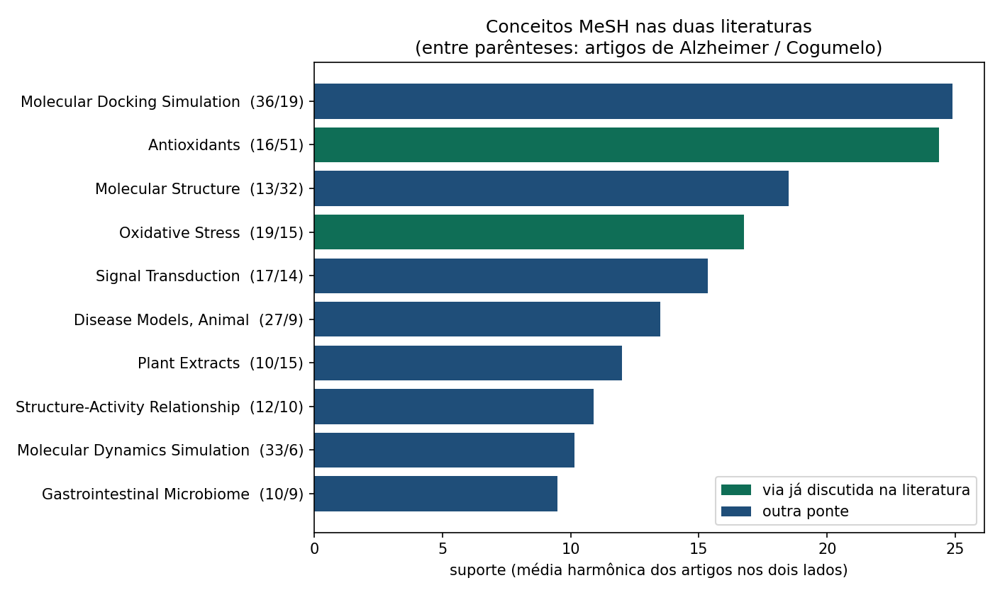

# Ranqueamento de Conceitos Ponte com Aprendizado de Máquina

Pipeline genérico para juntar duas literaturas científicas distantes no PubMed e ranquear **conceitos ponte** (descritores MeSH) que possam sugerir hipóteses para investigação.

> Trabalho de *Tópicos Especiais em Sistemas Inteligentes: Aprendizado de Máquina*  
> CEFET-MG Campus V · Hugo Henrique Marques

---

## O que o método faz

Dadas duas consultas (`A` e `C`), o pipeline:

1. **Coleta** artigos recentes do PubMed (só `A`, só `C`, e a interseção).
2. **Separa** as literaturas com classificadores lineares sobre TF-IDF (título + resumo).
3. **Filtra e ranqueia** descritores MeSH compartilhados por um suporte (média harmônica das contagens).
4. **Valida** o ranking com enriquecimento nos artigos que já citam os dois temas (fora do cálculo do ranking).

A saída é uma lista curta e rastreável de coocorrências. **Coocorrência indexada não prova relação causal** — serve como hipótese para revisão de domínio e experimento.

```
PubMed (A, C, A∩C)
        │
        ├─► Camada 1: TF-IDF + RL / Naive Bayes / SVM
        │         └─► distância lexical entre literaturas
        │
        └─► Camada 2: MeSH compartilhados
                  ├─ filtro (genéricos, consultas, cobertura)
                  ├─ ranking por suporte s(B)
                  └─ validação por enriquecimento E(B)
```

---

## Pares avaliados

| `PAR_ID` | Tipo | Papel no estudo |
|---|---|---|
| `cogumelo_alzheimer` | alimento–doença (distante) | estudo principal |
| `parkinson_alzheimer` | literaturas próximas | controle de generalização |
| `couve_anemia` | alimento–doença (interseção rara) | segundo par distante |

Trocar de tema = só escolher outro `PAR_ID`. Consultas, exclusões e MeSH das consultas ficam em `par.py`.

---

## Resultados resumidos

Regressão logística **sem** as palavras da consulta; mediana de enriquecimento no top-10 filtrado:

| Par | F1 (teste) | Mediana E | Presentes em “ambas” |
|---|---:|---:|---:|
| Cogumelo–Alzheimer | 0,966 | 1,65 | 9/10 |
| Parkinson–Alzheimer | 0,906 | 0,68 | 10/10 |
| Couve–Anemia | 0,960 | 0,00 | 4/10 |

No par principal, o filtro eleva o enriquecimento frente à frequência bruta (1,65 vs 1,08). No controle próximo o topo fica mais genérico; em couve–anemia a interseção MeSH é mínima e a validação fica instável — exatamente o tipo de viés discutido no artigo.

<p align="center">
  
</p>

---

## Como rodar

### 1. Ambiente

```bash
python3 -m venv .venv
source .venv/bin/activate
pip install -r requirements.txt
```

Opcional — e-mail de cortesia para a API do NCBI (E-utilities):

```bash
echo 'NCBI_EMAIL=seu@email.com' > .env
```

### 2. Escolher o par e coletar

```bash
export PAR_ID=cogumelo_alzheimer   # ou parkinson_alzheimer | couve_anemia

python coleta.py
```

A coleta baixa só um recorte dos artigos **mais recentes** por ano (não a literatura inteira) e grava em `data/`.

### 3. Classificar e ranquear pontes

```bash
python separar_literaturas.py   # métricas, CV, bootstrap, McNemar, figura de termos
python pontes_mesh.py           # ranking MeSH, enriquecimento, permutação, figura
```

Saídas típicas em `data/` e `figuras/`:

- `metricas_*.csv`, `validacao_cruzada_*.csv`, `bootstrap_*.csv`, `mcnemar_*.csv`
- `pontes_mesh_*.csv`, `validacao_pontes_*.csv`
- `termos_*.png`, `pontes_mesh_*.png`

---

## Estrutura

```
.
├── par.py                 # catálogo de pares (PAR_ID)
├── coleta.py              # orquestra a coleta
├── coleta_pubmed.py       # cliente PubMed (E-utilities)
├── separar_literaturas.py # camada 1 — classificadores
├── pontes_mesh.py         # camada 2 — ranking MeSH
├── requirements.txt
├── figuras/               # gráficos gerados
└── data/                  # corpora e tabelas (local; ignorado no git)
```

---

## Detalhes do protocolo

- **Representação:** TF-IDF (uni/bigramas, `min_df=3`, `sublinear_tf`, stop words em inglês)
- **Modelos:** regressão logística L2 (`C=1`, classes balanceadas), MultinomialNB, LinearSVC
- **Avaliação:** split estratificado 80/20 (semente 42), CV 5-fold no treino, bootstrap 1000×, McNemar
- **Pontes:** filtro de genéricos + MeSH das consultas + cobertura ≥ 25% ou &lt; 3 artigos/lado; suporte = média harmônica; validação por mediana de enriquecimento + teste de permutação

Para outro tema, adicione uma entrada em `PARES` dentro de `par.py` (consultas, exclusões, MeSH das consultas e, opcionalmente, vias já conhecidas só para marcar a figura).

---

## Artigo

Versão em LaTeX (IEEE) do trabalho acadêmico correspondente a este código. O PDF discute viés de consulta, atraso/viés de indexação MeSH e a distinção entre coocorrência e relação científica.

---

## Licença e uso

Código de trabalho acadêmico. Use e adapte citando o repositório e o artigo. Respeite os [termos de uso das E-utilities do NCBI](https://www.ncbi.nlm.nih.gov/books/NBK25497/).
